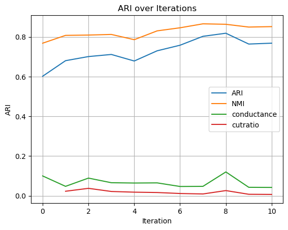

# Constrained Graph Clustering: A Spectral Algorithm with Generalized Eigenvectors

This repository is the official implementation of *Constrained Graph Clustering: A Spectral Algorithm with Generalized Eigenvectors*.

The repository provides:

- **CSC** — Constrained Spectral Clustering (Algorithm 1 in the paper), a single-pass spectral algorithm based on a generalized eigenproblem $L_G v = \lambda L_H v$ derived from a must-link graph $G$ and a cannot-link graph $H$.
- **ICSC** — Iterative Constrained Spectral Clustering, which alternates between cannot-link graph construction and the CSC eigensolve to refine the partition.

Three datasets are included as reproducible benchmarks: **MNIST**, **USPS**, and a **Stochastic Block Model (SBM)** synthetic graph.

## Requirements

We use `python = 3.10.18`. The project depends on standard scientific Python packages (`numpy`, `scipy`, `scikit-learn`, `networkx`, `matplotlib`, `tqdm`, `keras`, `tensorflow`). To install:

```setup
pip install -r requirements.txt
```

The MNIST dataset is downloaded automatically through `keras.datasets`. The USPS dataset is shipped under `datasets/usps/usps.h5`. The SBM dataset is generated synthetically inside the script — no external download is required.

## Training

Our method is unsupervised and model-free: there are no trainable parameters and no separate training phase. Each script directly performs spectral clustering and reports metrics.

## Evaluation

### Constrained Spectral Clustering (CSC)

For Algorithm 1 in the main paper, six entry points are provided — one `.ipynb` and one `.py` per dataset:

| Dataset | Notebook | Script |
|---|---|---|
| MNIST | `CSC_MNIST.ipynb` | `CSC_MNIST.py` |
| USPS  | `CSC_USPS.ipynb`  | `CSC_USPS.py`  |
| SBM   | `CSC_SBM.ipynb`   | `CSC_SBM.py`   |

If your environment supports Jupyter, we recommend the `.ipynb` versions for inspecting intermediate results and curves. Otherwise, the `.py` files produce equivalent output. Example (MNIST):

```eval
python CSC_MNIST.py
```

The expected output is similar to:

```shell
Spectral clustering ARI between clustering and true labels: 0.602156621543045
Spectral clustering NMI between clustering and true labels: 0.7684961947548055
Spectral clustering cut:  0.10006303183107469

Constrained Spectral Clustering ARI: 0.9590
Constrained Spectral Clustering NMI: 0.9471
cutratio  0.005300042701765844
Conductance  0.045392613840086055
```

(Some library warnings may also be printed.) The default setting is $cl = 20$, matching the row reported in **Table 1** of the paper. The resulting CSC ARI is approximately $0.93$, while the unconstrained spectral baseline is approximately $0.6$. Hyperparameters are exposed as variables at the top of each script — for example, `n_cl` controls the number of cannot-link constraints per node, and `eps` controls the degree-blending parameter $\varepsilon$ used in the double-normalized Laplacian.

### Iterative Constrained Spectral Clustering (ICSC)

ICSC has the same file layout as CSC:

| Dataset | Notebook | Script |
|---|---|---|
| MNIST | `ICSC_MNIST.ipynb` | `ICSC_MNIST.py` |
| USPS  | `ICSC_USPS.ipynb`  | `ICSC_USPS.py`  |
| SBM   | `ICSC_SBM.ipynb`   | `ICSC_SBM.py`   |

To run:

```eval
python ICSC_MNIST.py
```

ICSC on MNIST can take roughly half an hour, since each outer iteration solves a generalized eigenproblem on a 60k-node graph. The script prints per-iteration ARI / NMI / conductance / cut-ratio and finally plots the convergence curves:



### Multi-dataset Comparison Against Baselines

To reproduce the cross-dataset comparison table in the paper, run:

```eval
python compare_multi_ncl20_with_cucuringu.py
```

This script evaluates **five methods** on **16 datasets** with a fixed cannot-link budget of $cl = 20$:

- **SC** — unconstrained spectral clustering
- **Wang (2014)** — Algorithm 2 from Wang et al., *Flexible Constrained Spectral Clustering*
- **Lu & Carreira-Perpiñán (2008)** — kernel-based constrained spectral clustering
- **Cucuringu et al. (2016)** — *Scalable Constrained Clustering: A Generalized Spectral Method*
- **Ours** — CSC with the best $\varepsilon$ from a small grid `{0.05, 0.20, 0.50, 0.70, 0.85, 0.95}`

The 16 datasets cover image (MNIST, USPS, Fashion-MNIST, Pendigits, Optdigits, Letter-Recognition, Digits-8x8, Olivetti-Faces, COIL-20, mfeat-pixel, Semeion, HAR) and text (BBC-News, AG-News under both TF-IDF→LSA-300 and MiniLM-L6 embeddings) modalities. Datasets that fail to download are skipped automatically. The script prints a final summary table with the winning method per row highlighted in bold.

> Note: The MiniLM text rows additionally require `sentence-transformers` (`pip install sentence-transformers`); rows requiring it are skipped if the package is unavailable.

## Pre-trained Models

Not applicable. The algorithms in this paper are unsupervised spectral methods with no learnable weights, so there is nothing to pre-train or distribute. The full pipeline — graph construction, generalized eigensolve (LOBPCG / `eigsh`), and k-means rounding — runs end-to-end from the scripts above.

## Results

Our method achieves the following performance on the three benchmarks (default settings, $cl = 20$ for MNIST/USPS):

| Dataset | Method | ARI | NMI |
| --- | --- | :---: | :---: |
| MNIST (60k) | Spectral Clustering (baseline) | ~0.60 | ~0.77 |
| MNIST (60k) | **CSC (ours)** | **~0.93** | **~0.94** |
| USPS | Spectral Clustering (baseline) | see script | see script |
| USPS | **CSC (ours)** | see script | see script |
| SBM ($n=5000$, $k=10$, $p=0.2$, $q=0.155$) | Spectral Clustering (baseline) | see script | see script |
| SBM ($n=5000$, $k=10$, $p=0.2$, $q=0.155$) | **CSC (ours)** | see script | see script |

To reproduce a row, run the corresponding script listed in the **Evaluation** section. ICSC further improves these numbers by iterating cannot-link graph construction and the CSC eigensolve; see `ICSC_*.py` and the curve in `output.png`.

## File Overview

Core implementation:

- `utils.py` — graph construction (k-NN, cannot-link, SBM), normalized / double-normalized Laplacians, the CSC and ICSC solvers, and clustering-quality metrics (cut, ratio cut, conductance).

Algorithm entry points:

- `CSC_{MNIST,USPS,SBM}.{py,ipynb}` — Algorithm 1 (CSC).
- `ICSC_{MNIST,USPS,SBM}.{py,ipynb}` — iterative variant.

Auxiliary experiments referenced in the paper (ablations, baseline comparisons, runtime studies, eigenvalue-gap analysis, etc.) live alongside in scripts such as `compare_*.py`, `eigenvalue_gap_*.py`, `lambda_phi_analysis.py`, `upsilon_*.py`, and `tune_*.py`.

## Contributing

This repository accompanies a paper submission and is released for the purpose of reproducibility and academic review. Issues and pull requests for bug fixes or clarifications are welcome.
